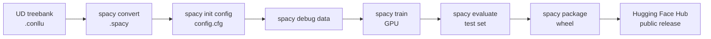

# en-ud-trf


Training a spaCy transformer (RoBERTa) POS tagger and Universal Dependencies parser for English, to be released under an explicit license.

The model is meant to replace `en_ud_L1_combined_trf` in [V-CAT](https://github.com/RusCucumber/V-CAT) (see V-CAT #235). That model repackages the one from Kyle & Eguchi (2024), but neither its [source repository](https://github.com/LCR-ADS-Lab/l2-nlp-training-spacy) nor its [OSF page](https://osf.io/axw3g/) states a license, so it cannot be redistributed. This repository retrains an equivalent model from openly licensed treebanks so that V-CAT and other applications can depend on it.

> [!NOTE]
> Work in progress. The training pipeline below is the plan; it is not implemented yet.

## Contents

- [Target Model](#target-model)
- [Pipeline](#pipeline)
- [Setup](#setup)
- [Environment Variables](#environment-variables)
- [Workflow](#workflow)
- [Coding Agent (Claude Code)](#coding-agent-claude-code)
- [Project Structure](#project-structure)
- [References](#references)

## Target Model

The model must stay compatible with how V-CAT uses the current `en_ud_L1_combined_trf` (v1.0.2):

| Item                 | Target                                                                                       |
| -------------------- | -------------------------------------------------------------------------------------------- |
| Pipeline             | `transformer` → `tagger` → `parser` (no lemmatizer; V-CAT adds one from `en_core_web_sm`)    |
| Base model           | `roberta-base`                                                                               |
| Tagger labels        | Penn Treebank XPOS (V-CAT detects verbs by `token.tag_`)                                     |
| Parser labels        | UD v2 dependency relations (V-CAT's frames and rules use `token.dep_`)                       |
| Library versions     | `spacy>=3.5.3,<3.6.0`, `spacy-transformers==1.2.5`, `transformers<4.31` (same pins as V-CAT) |
| Current scores (dev) | tag_acc 0.972 / UAS 0.937 / LAS 0.917                                                        |

**License**: the model's license follows its training data. With [UD_English-EWT](https://github.com/UniversalDependencies/UD_English-EWT) (CC BY-SA 4.0) the model would be released under CC BY-SA 4.0 (`roberta-base` is MIT). The final treebank selection is still open.

## Pipeline



1. **Data**: choose and pin UD treebanks (release and commit hash), check their licenses.
2. **Convert**: CoNLL-U → `.spacy` with `spacy convert --converter conllu --n-sents 10`.
3. **Config**: start from `spacy init config --pipeline tagger,parser --optimize accuracy --gpu`, then match the current model's settings (e.g., `max_steps` 20000, `warmup_linear` with `initial_rate` 1e-4).
4. **Train** on a CUDA GPU; record the seed, treebank release, config, and library versions.
5. **Evaluate** on the test set against the current model, and run V-CAT's regression checks (frequency tables of syntactic frames).
6. **Package** as a wheel under a new name (e.g., `en_ud_trf`) with the license and sources in `meta.json`.
7. **Release** publicly on the Hugging Face Hub, so that `pip`/`uv` can install it without authentication.

## Setup

Requires [uv](https://docs.astral.sh/uv/getting-started/installation/) and [GitHub CLI](https://cli.github.com/). Training needs a CUDA GPU.

```bash
git clone https://github.com/RusCucumber/en-ud-trf.git
cd en-ud-trf
uv sync
```

For Claude Code, also log in to GitHub CLI (`gh auth login`) and install the plugins ([docs/manual_setup_flow.md](./docs/manual_setup_flow.md), steps 2 and 4).

> [!IMPORTANT]
> Claude Code's git commands run over **HTTPS + GitHub CLI** (SSH does not work inside its sandbox). This is set only for Claude via `env` in `.claude/settings.json` — your own SSH setup and global git/gh config stay unchanged; just run `gh auth login` once.

## Environment Variables

| File     | Role                                                                              | Loaded by                     |
| -------- | --------------------------------------------------------------------------------- | ----------------------------- |
| `.env`   | Project secrets & settings (e.g., `HF_TOKEN`)                                     | `.envrc` (via direnv)         |
| `.envrc` | Shell environment for the project directory (e.g., load `.env`, activate `.venv`) | [direnv](https://direnv.net/) |

Both files are **git-ignored** and **unreadable by Claude Code** (`.claude/settings.json`).
Keep values in `.env` and let `.envrc` just load it, so that Python and the shell share one source:

```bash
# .envrc
dotenv_if_exists .env
export VIRTUAL_ENV="$PWD/.venv"
PATH_add .venv/bin
```

Set up direnv once:

```bash
brew install direnv                                  # or see https://direnv.net/docs/installation.html
echo 'eval "$(direnv hook zsh)"' >> ~/.zshrc         # use your shell's hook
direnv allow                                         # run again after every .envrc change
```

- **Zed**: `.zed/settings.json` sets `"load_direnv": "direct"`, so language servers (ty, ruff), tasks and the terminal get the `.envrc` variables. Reopen the project after `direnv allow`.

> [!WARNING]
> Variables exported by direnv are visible to commands Claude Code runs (if launched from that shell), even though it cannot read the files. Do not export secrets you do not want an agent to use.

## Workflow

This repository follows **GitHub Flow**: branch off `main`, open a pull request, and merge back after review. Issues and pull requests are added to the [Task Manager project board](https://github.com/users/RusCucumber/projects/1) by `.github/workflows/add-to-task-manager.yml`.

1. Create an issue from a template in `.github/ISSUE_TEMPLATE/` (Engineering / Analysis / General Task).
2. Create a branch named `<prefix>/<descriptive-name>-#<issue-number>` (e.g., `feat/conllu-converter-#12`).
3. Commit with a tag: `[add]`, `[upd]`, or `[fix]` (e.g., `[add] conllu converter`).
4. Open a pull request to `main`.

| Prefix        | File types        | Description                                   | Issue template   |
| ------------- | ----------------- | --------------------------------------------- | ---------------- |
| `feat/`       | `.py` (package)   | Common functions, class design                | Engineering Task |
| `fix/`        | `.py`             | Bug fixes in functions                        | Engineering Task |
| `test/`       | `.py`             | Test case additions or modifications          | Engineering Task |
| `analysis/`   | `.py` (marimo)    | Analysis and visualization in notebooks       | Analysis Task    |
| `experiment/` | `.py` (marimo)    | Experimental code in notebooks                | Analysis Task    |
| `data/`       | `.conllu`, `.csv` | Manual data corrections & cleaning            | General Task     |
| `doc/`        | `.md`             | Documentation & paper writing                 | General Task     |
| `chore/`      | any               | Environment & dependency updates, other tasks | General Task     |

Descriptive names should be concise, lowercase, and hyphen-separated.
Claude Code follows the same conventions through the `git-strategy` skill.

> [!NOTE]
> The Python test workflow (`.github/workflows/python_tests.yaml`, which runs pytest in the `Dockerfile` image) is currently disabled until tests exist.

## Coding Agent (Claude Code)

This repository is preconfigured for Claude Code. Details: **[docs/claude_code.md](./docs/claude_code.md)**.

- **Plugins**: [oh-my-claudecode](https://github.com/Yeachan-Heo/oh-my-claudecode), [superpowers](https://github.com/obra/superpowers), [genshijin](https://github.com/InterfaceX-co-jp/genshijin), and [claude-mem](https://github.com/thedotmack/claude-mem). They are not downloaded automatically — install them with [step 4 of the manual setup](./docs/manual_setup_flow.md#4-install-claude-code-plugins) (`claude-mem` needs [Bun](https://bun.sh/)).
- **Rules** (`.claude/rules/`): short project rules; most load only when Claude touches matching files.
- **Skills** (`.claude/skills/`): Python environment, notebooks, git workflow, and document tools. Update the upstream ones with `gh skill update`.
- **Instructions**: write project-specific instructions in the root `CLAUDE.md`, not in `.claude/CLAUDE.md` (managed by oh-my-claudecode).
- **Extras**: second-opinion reviews with Codex (`/oh-my-claudecode:ask codex`), an Obsidian vault via MCP, and token-saving tips.

## Project Structure

```
.
├── assets/                          # Raw data (e.g., UD treebanks in .conllu); git-ignored
├── corpus/                          # Training data (e.g., .spacy corpora); git-ignored
├── src/
│   └── en_ud_trf/                   # Main Python package
├── tests/                           # pytest test cases
├── notebooks/
│   └── python/                      # marimo notebooks
├── results/
│   ├── tables/                      # Generated tables
│   ├── figures/                     # Generated figures
│   └── models/                      # Trained models
├── docs/
│   ├── manual_setup_flow.md         # Manual setup steps
│   └── claude_code.md               # Claude Code configuration
│
├── .claude/
│   ├── settings.json                # Plugins, permissions, sandbox
│   ├── rules/                       # Project rules for Claude
│   └── skills/                      # Agent Skills
├── .github/
│   ├── ISSUE_TEMPLATE/              # Issue templates
│   ├── workflows/                   # Project board automation, Python tests
│   ├── labels.json                  # Issue labels
│   └── ruleset-main_push_block.json # Branch ruleset for main
├── .vscode/                         # VS Code settings
├── .zed/                            # Zed settings and tasks
│
├── pyproject.toml                   # Python project configuration
├── uv.lock                          # uv lock file
├── .python-version                  # Python version
├── Dockerfile                       # Python test image
├── CLAUDE.local.md                        # Project instructions for Claude (create per project)
└── README.md
```

## References

- Kyle, K., & Eguchi, M. (2024). Evaluating NLP models with written and spoken L2 samples. _Research Methods in Applied Linguistics_, _3_(2), 100120. https://doi.org/10.1016/j.rmal.2024.100120
- Kyle, K., Eguchi, M., Miller, A., & Sither, T. (2022). A dependency treebank of spoken second language English. _BEA 2022_, 39–45. https://doi.org/10.18653/v1/2022.bea-1.7
- spaCy documentation: [Training](https://spacy.io/usage/training), [CLI](https://spacy.io/api/cli), [Projects](https://spacy.io/usage/projects)
